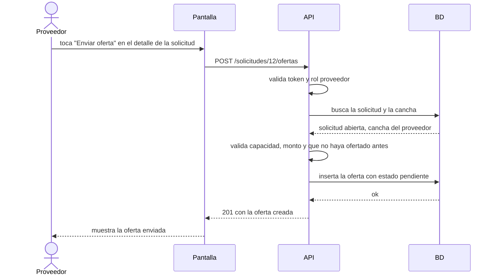

# Hito 1 · Addendum técnico

**Pareja:** Quiijije jose - Alan john
**Paralelo:** A

## A. Estructura del proyecto

```
.
├── main.go                       # arranque: carga la configuración, conecta a PostgreSQL y levanta el servidor
├── go.mod
├── .env.example                  # variables de entorno de ejemplo, sin datos reales
├── internal/
│   └── reservas/
│       ├── modelos.go            # structs de GORM y JSON (Usuario, Solicitud, Oferta, Reserva, Pago...)
│       ├── manejadores.go        # lógica de cada endpoint y sus validaciones
│       ├── rutas.go              # registro de rutas y middleware de autenticación por rol
│       └── manejadores_test.go   # pruebas de los endpoints
└── docs/
    └── hito1_addendum.md         # este documento, con sus capturas
```

## B. Configuración y secretos

| Variable | Para qué sirve | Ejemplo (sin datos reales) |
|----------|----------------|----------------------------|
| `DB_HOST` | Servidor de PostgreSQL | `localhost` |
| `DB_PORT` | Puerto de PostgreSQL | `5432` |
| `DB_USER` | Usuario de la base de datos | `postgres` |
| `DB_PASSWORD` | Contraseña de la base de datos | `cambiar_esto` |
| `DB_NAME` | Nombre de la base de datos | `reservas_canchas` |
| `JWT_SECRET` | Clave para firmar los tokens de autenticación | `clave_larga_de_ejemplo` |
| `PORCENTAJE_COMISION` | Porcentaje que la app cobra por reserva | `0.10` |
| `PORT` | Puerto en el que escucha el servidor | `8080` |

**Archivo de ejemplo:** `.env.example` en la raíz del repositorio. El archivo `.env` real está en `.gitignore` y el repositorio no contiene credenciales reales.

## C. Pruebas

| Prueba | Qué caso cubre |
|--------|----------------|
| `TestCrearSolicitud_Exitoso` | Un cliente autenticado crea una solicitud válida y recibe 201 con estado `abierta` |
| `TestCrearSolicitud_FechaPasada` | Una solicitud con `fecha_evento` en el pasado es rechazada con 422 |
| `TestCrearSolicitud_ComoProveedor` | Un proveedor intenta crear una solicitud y recibe 403 |
| `TestEditarSolicitud_NoAbierta` | Editar una solicitud ya adjudicada devuelve 409 |
| `TestEnviarOferta_CanchaAjena` | Un proveedor ofertando con una cancha que no es suya recibe 403 |

**Captura de `go test ./...`:** 

## D. Boceto de la pantalla principal

Pantalla "Solicitudes abiertas" (vista del proveedor), que consume `GET /solicitudes`:

```
┌─────────────────────────────────────────┐
│  Solicitudes abiertas                   │
├─────────────────────────────────────────┤
│  Fútbol · 12 personas       [ABIERTA]   │
│  15/10/2026 19:00 · 90 min              │
│  Presupuesto máximo: $40.00             │
│  Extras: bebidas, arbitraje             │
│                         [ Ver detalle ] │
├─────────────────────────────────────────┤
│  Pádel · 4 personas         [ABIERTA]   │
│  16/10/2026 18:00 · 60 min              │
│  Presupuesto máximo: $20.00             │
│                         [ Ver detalle ] │
└─────────────────────────────────────────┘
```


## E. Diagrama de secuencia del caso de uso principal

Caso de uso: un proveedor envía una oferta a una solicitud abierta.



## F. Capturas de respuestas


